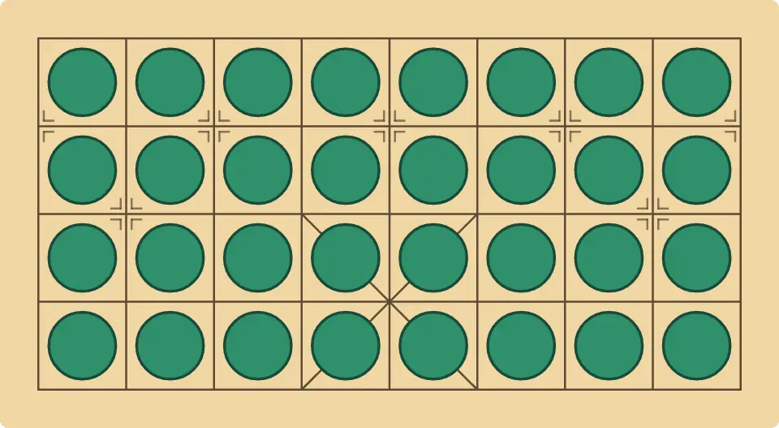

# MistyBanqi

[](https://github.com/brianhliou/misty-banqi/actions/workflows/ci.yml)
[](https://github.com/brianhliou/misty-banqi/releases/latest)
[](LICENSE)

A [Banqi](https://en.wikipedia.org/wiki/Banqi) (Chinese Dark Chess) engine in Rust: αβ search
with **Star1 chance-node expectiminimax** for the hidden-tile flips, a transposition table,
repetition handling, quiescence, and classical or optional NNUE evaluation. Ships as a UCI binary, with
the same search core exposed to Python via PyO3.

Banqi is a hidden-information game: pieces start face-down and flip to reveal during play, so a
move is either a deterministic move/capture or a chance event drawn from the bag of unrevealed
pieces. That mix of decision and chance nodes is the heart of the engine.

<p align="center">
  <a href="https://mistboard.com/?play=computer&gameSpecId=banqi">
    
  </a>
  <br>
  <sub><i>A MistyBanqi self-play game.</i></sub>
</p>

**Play it** against the computer on [mistboard.com](https://mistboard.com/?play=computer&gameSpecId=banqi),
where this engine is the Banqi opponent ([rules](https://mistboard.com/rules/banqi)). Full build
report: [Building a Banqi Engine](https://brianhliou.com/posts/building-banqi-engine/).

## How it works

**Search: αβ + Star1 over a mixed decision/chance tree.** A flip is a chance node: the engine
knows only the public bag of remaining pieces, not which one a given tile holds. Star1 takes the
probability-weighted expectiminimax value over bag outcomes with αβ-style bounds (`flip_value` in
[`engine.rs`](banqi_rust/src/engine.rs)), pruning chance branches instead of expanding all ~14.
Decision nodes are ordinary αβ negamax.

**Machinery.** A Zobrist transposition table keyed on (board, bag, side-to-move); repetition
detection with contempt (avoid draws when ahead, seek them when losing) plus a root anti-draw-sac
guard; quiescence over captures; iterative deepening under a node budget (`go nodes N`).

**Classical evaluation.** Material on a corrected value table, covered-piece
("full-alive") material so a flip never creates phantom value, value-aware mobility,
context-dependent general value, an adaptive *domination* term (a piece is worth more as the
enemies that could capture it dwindle), and a general-safety term.

## Build & run

The UCI binary (no Python needed):

```sh
cargo build --release -p banqi-engine
echo "uci" | ./target/release/banqi-engine        # → id name MistyBanqi 0.3.0 ...
```

Drive it over UCI with a Banqi FEN (face-down tile = `X`; turn `r`/`b`/`-`; then the bag and clock):

```
uci
position fen XXXXXXXX/XXXXXXXX/XXXXXXXX/XXXXXXXX - <bag> 0 1
go nodes 1500000
```

The Python bindings (the same search core via PyO3):

```sh
pip install maturin
maturin develop --release -m banqi_rust/Cargo.toml
python -c "import banqi_rust; print([f for f in dir(banqi_rust) if not f.startswith('_')])"
```

The browser build is single-threaded WebAssembly:

```sh
wasm-pack build banqi-wasm --target web --release
```

It exposes one-shot `analyze` plus a stateful `AnalysisSession`. Repeated bounded
`step(nodes)` calls preserve iterative-deepening state, the transposition table, and
move-ordering history while giving the browser a cancellation boundary between slices.

## Weaker play

Set these UCI options before `ucinewgame`. Settings persist across games.

| Option | Default | Meaning |
| --- | --- | --- |
| `Noise` | `0` | Finite, nonnegative Gaussian standard deviation in native [-1, 1] score units. Fractional values are accepted. Zero keeps the normal search. |
| `NoiseDepth` | `1` | Integer from 1 to 8. Maximum depth for scoring each root move before adding noise, including flips. |
| `Seed` | `0` | Unsigned 64-bit integer. Nonzero values replay choices for the same position, settings and completed depth. Zero uses fresh entropy. |

Noisy search deepens one ply at a time and uses the deepest completed pass under
`go nodes` and `movetime`. Depth 1 always completes, even with a smaller budget.
It takes immediate wins, checks every possible flip reveal to avoid immediate
losses when a safe move exists, and preserves terminal win/loss scores found by
completed passes. Draws keep the normal contempt score.

## NNUE evaluation

No trained net ships with the engine. `EvalFile` defaults to empty, using
classical evaluation. To load a separately supplied BQNN v2 file:

```text
uci
setoption name EvalFile value /path/to/evaluation.bqnn
isready
position fen XXXXXXXX/XXXXXXXX/XXXXXXXX/XXXXXXXX - G1A2E2R2H2C2S5g1a2e2r2h2c2s5 0 1
go nodes 5000 movetime 0
```

Paths may contain spaces and need no quotes. An empty value or `<empty>` restores
classical evaluation. A failed load reports
`info string error EvalFile: ...; using classical` and clears any previous net.
Options persist across `ucinewgame`.

The reader accepts **BQNN v2**: a `BQNN` magic header, five little-endian 32-bit
integers (version 2, 576 features, hidden width 1–4096, 16, 32), then little-endian
float32 weights in the order documented in
[`nnue.rs`](banqi-engine/src/nnue.rs). UCI loading also checks that weights fit the
integer accumulator. The payload order is `FT[576,H]`, `FT bias[H]`,
`W1[16,2H]`, `b1[16]`, `W2[32,16]`, `b2[32]`, `W3[1,32]`, `b3[1]`.
FT rows are feature-major and dense rows are output-major. Total file length is
`24 + 4 * (609 * H + 593)` bytes, with no padding or trailing bytes. All weights
must be finite with absolute value at most 1,000,000.

Features describe public piece locations relative to each seat's colour, covered
tiles, bag-count thresholds, the no-progress clock, repetition and turn flags.
NNUE uses integer incremental accumulators and quantized dense layers; terminal
results remain exact rule outcomes.

Net mode uses zero contempt, four capture-quiescence plies, and a depth ceiling of
64. It carries exact threefold/chase state through the tree and disables the
position-only transposition table and approximate cycle draws. Classical mode
keeps its existing settings. `NoProgressLimit` remains 40 by default in both modes;
`go searchmoves`, node/time limits, FEN and move notation retain the public protocol.
`Noise`, `NoiseDepth` and `Seed` work with either evaluator.
See the [validation record](docs/0.3.0-validation.md) for the complete settings and fixtures.

For validation without a trained net, run `cargo test --workspace`. The loader,
inference, features, rules and UCI tests use synthetic weights built in the tests.
Two trained-net checks print a skip message unless `MISTY_BANQI_EVALFILE` is set:

```sh
MISTY_BANQI_EVALFILE=/path/to/evaluation.bqnn cargo test --workspace
```

The fixed-node NNUE fixture requires the net used by its reference engine.
Keep evaluation files outside this repository; a repository scan checks for both
`.bqnn` files and files beginning with the `BQNN` magic bytes.

## Layout

```
banqi_rust/      engine core (engine.rs) + PyO3 Python bindings (lib.rs)
banqi-engine/    standalone UCI binary, NNUE inference and protocol fixtures
banqi-wasm/      wasm-bindgen browser API, including incremental analysis sessions
.github/workflows/  ci (build + uci smoke) and release (tag → published binary)
```

## Acknowledgements

The handcrafted evaluation started from [george0828Zhang/chinese-dark-chess-hw](https://github.com/george0828Zhang/chinese-dark-chess-hw).
The context-dependent
general value and the value-weighted mobility, in particular, are adapted from it.

## License

MIT, see [LICENSE](LICENSE).
